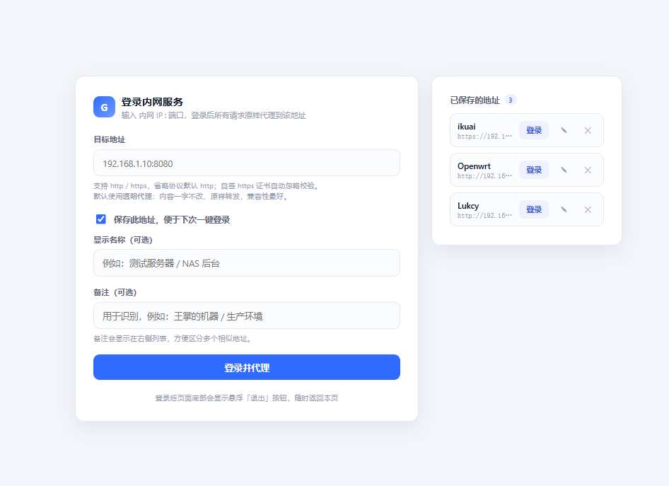

# SimpleProxy

[](https://github.com/virkingz/simpleProxy/actions/workflows/docker.yml)

带 **Token 门禁**的网页版内网代理网关。通过浏览器访问网关，用 Token 进入后输入「内网 IP:端口」登录，
之后**该会话的所有请求都会被代理到目标地址**；保存过的地址显示在右侧，可一键登录；退出后回到登录页。



> 左侧填写「内网 IP:端口」并可选保存；右侧是已保存地址列表，点「登录」即一键进入。

## 功能

- **透明代理（默认）**：nginx 风格，**内容一字不改**原样转发 —— 不改写 HTML/JS/CSS、不加参数、不打乱 Cookie，兼容性最好
- **Token 门禁**：必须先输入正确 Token 才能进入网关页面，会话保持 12 小时
- **目标登录**：输入 `内网IP:端口`（支持 `http://` / `https://`，省略协议默认 http）
- **Cookie 原样透传**：目标自己的会话 Cookie 完整送达，登录状态不会丢
- **支持 WebSocket**：终端、实时日志、Jupyter 等长连接场景可用
- **忽略后端证书**：目标为自签 https 时自动跳过证书校验
- **保存与一键登录**：勾选保存后可命名并填备注；已保存地址显示在右侧列表，点击即登录
- **备注识别**：备注显示在列表条目下，可通过 ✎ 内联编辑，方便区分多个相似地址
- **SQLite 持久化**：保存的地址存 SQLite（Node 22 内置驱动，零原生依赖），挂载卷即可跨重启保留
- **悬浮退出按钮**：被代理页面右下角自动追加「退出」按钮，随时返回登录页

## 代理模式

默认（也是唯一推荐）的工作方式是 **透明代理**，即 nginx 的 `proxy_pass` 语义：

### 透明代理（默认，推荐）

nginx 风格：**完全不碰响应体**。不注入、不重写 origin、不加 `_gw`、不去 base；只做「换 Host 转发 + 透传状态码/响应头/Set-Cookie/Location」。
唯一改动是在 HTML 的 `</body>` 前追加一个悬浮「退出」按钮（可用 `INJECT_EXIT_BUTTON=false` 关闭），**只追加、不改写任何既有内容**。

为什么它最不容易白屏：改写 HTML/JS 是侵入式的，现代前端（Vite 的动态 `import()`、`__vite__mapDeps`、`modulepreload`、内联 worker、根绝对路径资源）一旦被改错一处就整页崩。透明转发让目标服务始终认为自己在根路径，前端拿到的是**一字未改**的原始代码，因此不存在「漏改」。

Cookie 也**原样透传**（只剔除网关自身的会话 Cookie）：目标下发的会话 Cookie 会完整回到浏览器并在后续请求中原样送达，因此目标的登录状态不会丢——不会出现「登录后提示登录已过期」。

### 退出即重置目标登录态

透明代理下浏览器认为所有内容都来自**网关这个源**，因此被代理页面自己的登录 Cookie 也记在网关源下。
若不清，下次代理同一服务会带着旧登录态、跳过目标自己的登录页。

「退出」时会做两件事（`CLEAR_TARGET_COOKIES_ON_EXIT=false` 可关闭）：

1. **服务端按台账精确过期登录 Cookie**：网关在转发时记录目标下发过的每个 `Set-Cookie` 的**名字 + Path**，退出时逐个下发 `Max-Age=0` 过期指令。这样即使 Cookie 是 `HttpOnly`（JS 读不到也删不掉）也能清除。
2. **前端清空同源 JS 存储**：`localStorage` / `sessionStorage` / `IndexedDB`（覆盖用前端存储 token 的服务）。

效果：退出后再代理该服务，**和第一次一样需要重新登录**。网关自身的 Token 门禁会话不受影响，下次打开网关无需重输 Token。

> 说明：删除 Cookie 必须 `名字 + Path` 精确匹配，因此台账记录的是目标**实际使用**的 Path（如 `/api` 而非笼统的 `/`），这是能真正删掉的关键。

### 关于 https 与混合内容

网关与目标之间**按目标自身 scheme 建连**（http ↔ https 可跨协议，自签证书已内置忽略），对外协议跟随网关本身，
因此不存在「http 页面请求 https 资源」的混合内容问题。

### 可选：路径代理 / 端口转发（默认关闭，一般无需使用）

源码中仍保留另两种模式，供特殊场景使用（需显式传 `mode=path` / `mode=port`，或设环境变量开启）：

| 模式 | 说明 |
| --- | --- |
| 路径代理 | 同端口用路径区分多个目标，会改写页面里的资源地址；复杂 SPA 有改写风险 |
| 端口转发 | 另开专属端口原样转发（http 场景）；目标为 https 时可能遇混合内容问题 |

对于「页面空白」类问题，请使用默认的透明代理。

### 环境变量开关

| 变量 | 默认 | 说明 |
| --- | --- | --- |
| `TRANSPARENT` | `true` | 是否提供透明代理模式（默认即使用） |
| `PORT_FORWARD` | `true` | 是否允许端口转发模式（需显式选 `mode=port`） |
| `PORT_FORWARD_START` / `PORT_FORWARD_END` | `20000` / `20999` | 端口转发分配范围 |
| `PORT_FORWARD_HOST` | 空 | 端口转发跳转时展示用的网关地址；留空则用浏览器当前主机名 |

## 目录结构

```
simpleProxy/
├── server.js                       # 服务端：Token 校验 / 会话 / 代理 / SQLite
├── public/index.html               # 前端：门禁页 + 登录页 + 右侧保存列表
├── package.json
├── Dockerfile
├── docker-compose.yml              # Compose：默认拉取 GHCR 镜像
├── docker-compose.build.yml        # Compose 覆盖文件：改为本地源码构建
├── .env.example
├── .github/workflows/docker.yml    # CI：构建并推送镜像到 GHCR
└── data/                           # 运行时生成，SQLite 数据（已挂载）
```

## 快速开始

### 方式一：Docker Compose（推荐）

```bash
cp .env.example .env
# 编辑 .env，务必修改 TOKEN
docker compose up -d
```

> 默认使用 CI 构建好的镜像 `ghcr.io/virkingz/simpleproxy:latest`，如需基于本地源码构建，加上覆盖文件：
> ```bash
> docker compose -f docker-compose.yml -f docker-compose.build.yml up -d --build
> ```

### 方式二：docker run 直接用镜像

```bash
# 镜像地址（public 仓库可直接拉取）
docker pull ghcr.io/virkingz/simpleproxy:latest

docker run -d --name simpleproxy \
  -p 8080:8080 \
  -e TOKEN=your-strong-secret-token \
  -v $(pwd)/data:/data \
  --restart unless-stopped \
  ghcr.io/virkingz/simpleproxy:latest
```

> 若仓库/包为 private，需先登录：`echo $GITHUB_TOKEN | docker login ghcr.io -u <你的用户名> --password-stdin`

### 方式三：手动构建

```bash
docker build -t simpleproxy .
docker run -d --name simpleproxy \
  -p 8080:8080 \
  -e TOKEN=your-strong-secret-token \
  -v $(pwd)/data:/data \
  --restart unless-stopped \
  simpleproxy
```

浏览器打开 `http://<宿主机IP>:8080`，输入设置的 `TOKEN` 即可进入。

`.env`：

```dotenv
TOKEN=your-strong-secret-token   # 进入网关的令牌，务必修改
GATE_PORT=8080                   # 宿主机映射端口
```

## CI / 镜像发布

`.github/workflows/docker.yml` 使用 GitHub Actions 自动构建镜像：

| 触发条件 | 行为 |
| --- | --- |
| push 到 `main` / `master` | 构建并推送，含 `latest` 标签 |
| push tag `v*` | 构建并推送语义化版本标签（如 `v1.2.0`、`1.2`） |
| Pull Request | 仅构建校验，不推送 |
| 手动触发（workflow_dispatch） | 构建并推送 |

镜像推送到 **GHCR**：`ghcr.io/virkingz/simpleproxy`，使用的标签由 `docker/metadata-action` 自动生成。

## 环境变量

| 变量 | 默认值 | 说明 |
| --- | --- | --- |
| `TOKEN` | `changeme` | **必改**。进入网关页所需的访问令牌 |
| `PORT` | `8080` | 容器内监听端口 |
| `DATA_DIR` | `/data`（镜像内） | SQLite 数据目录 |
| `INJECT_EXIT_BUTTON` | `true` | 是否向被代理 HTML 注入左上角悬浮退出按钮 |
| `CLEAR_TARGET_COOKIES_ON_EXIT` | `true` | 退出代理时是否「重置目标登录态」。透明代理下被代理页面自己的登录 Cookie 也存在网关源下；开启后退出时会按台账逐个过期这些 Cookie（含 HttpOnly），并由前端清空同源 `localStorage/sessionStorage/IndexedDB`，使下次代理该服务**和第一次一样要重新登录**。设 `false` 保留登录态 |
| `AUTH_DECOY` | `true` | **Token 校验诱饵**。开启后：任何（对或错）token 都返回**完全一致**的响应（状态码、body、Cookie 属性全同），且**登录后各端点的行为也与真实会话逐字段对齐**（`/me` 的 `hasTarget`/`mode`、`port` 模式的 `pfPort`、`/sites` 列表、`PATCH` 的 404……），让在线爆破无法通过任何响应差异判断对错。错误 token 得到的「诱饵会话」表面完全正常，但访问代理内容时只会看到「上游不可达」，且看不到任何真实内网数据。设 `false` 则恢复显式 401 + 失败锁定 |
| `AUTH_MAX_FAILS` | `5` | 静默节流阈值：窗口内尝试超过该次数后，登录请求被**逐次拉长延迟**（不改变响应内容）。诱饵模式下计数与对错无关，避免时序侧信道 |
| `AUTH_SILENT_DELAY_MS` | `400` | 静默节流的起始延迟（毫秒），随后指数增长 |
| `AUTH_SILENT_MAX_DELAY_MS` | `4000` | 静默节流延迟上限（毫秒） |
| `AUTH_LOCK_BASE_MS` | `1000` | **仅当 `AUTH_DECOY=false`**：失败后的指数退避基准时长（毫秒），上限 5 分钟 |
| `AUTH_FAIL_WINDOW_MS` | `900000` | 失败/尝试计数窗口（毫秒，默认 15 分钟） |
| `MAX_PENDING_SESSIONS` | `500` | **未认证会话**（含诱饵）数量上限。超过时按「最久未活跃」即时淘汰。防止无 Cookie 狂刷 `/auth` 撑爆内存 |
| `MAX_SESSIONS` | `2000` | 会话总数硬上限。超过时优先淘汰未认证会话，仍超出则连已登录会话一起按最久未用淘汰，保证内存绝不无界增长 |
| `SECURITY_HEADERS` | `true` | 是否给**网关自身**页面下发安全响应头（`X-Frame-Options: DENY`、CSP、nosniff、Referrer-Policy、HSTS）。**不会加到被代理的内容上**，透明代理「零改写」不受影响 |
| `HSTS_MAX_AGE` | `15552000` | HSTS 有效期（秒，默认 180 天）。仅在 HTTPS 请求下下发；设 `0` 关闭 |
| `TRUST_PROXY` | `false` | 网关前有 CDN/反代时设为 `true`，才会采信 `X-Forwarded-For` / `X-Forwarded-Proto`（影响限速取 IP 与 `Secure` 判定、HSTS）。直连内网时保持 `false`，否则这些头可被伪造 |
| `STRIP_CLIENT_HEADERS` | `true` | 转发给目标时清洗 `X-Forwarded-*` 并把 `Referer`/`Origin` 伪装成目标自身（仅页面/接口请求；静态资源会还原浏览器原生的 `Sec-Fetch-*` 且不注入 `Origin`）。目标做防盗链/Host 校验返回 403 时保持默认即可；设为 `false` 可 A/B 对比 |
| `PROXY_LOG` | `false` | 设为 `true` 时打印每个代理请求的**实际转发路径**与上游状态码（`docker logs -f simpleproxy`），并在响应里加 `X-Gate-Outgoing` / `X-Gate-Upstream` 头，DevTools 里可直接看出 404 来自哪一层、路径被改成了什么 |
| `AUTO_SUBPATH` | `true` | 静态资源在根路径被上游判 4xx 时，自动探测目标真实前缀并即时回源（探测同时尝试 gzip 协商与 http/https 两种协议）。设 `false` 关闭 |
| `PROBE_TIMEOUT_MS` | `1200` | 子路径探测单次超时（毫秒） |
| `CACHE_CONTROL` | `private, no-store, max-age=0, must-revalidate` | 所有网关响应（含代理透传）强制使用的缓存头。前面套 CDN 时**必须禁止共享缓存**，否则 404 会被缓存固化。可放宽为 `private, max-age=600`（仍禁 CDN 共享缓存） |
| `BUST_CDN_CACHE` | `true` | 给被代理 HTML 里的站内资源 URL 追加会话级 `_gw` 参数（转发给目标前自动剥离）。CDN 已缓存旧 404 时无需清缓存即可立刻绕过；设 `false` 关闭 |

## 使用流程

1. 打开网关地址 → 输入 **Token** 进入
2. 在「目标地址」输入 `内网IP:端口`，例如 `192.168.1.10:8080`
3. 需要下次一键登录就勾选「保存」，可填**显示名称**与**备注**（备注用于识别，例如「王掌的机器 / 生产环境」）
4. 点「登录并代理」→ 浏览器跳转到目标服务首页，此后所有请求都原样代理到该地址
5. 右下角悬浮按钮显示当前代理目标，点「退出」返回登录页
6. 保存过的地址显示在**右侧列表**，点「登录」即一键进入；点 **✎** 可随时修改名称与备注

## 代理宿主机上的服务

若目标服务跑在宿主机（如 `127.0.0.1:9000`），容器内需用 `host.docker.internal`：

1. 在 `docker-compose.yml` 打开 `extra_hosts` 注释（Linux 需要）
2. 登录时填 `host.docker.internal:9000`

## 安全说明

- Token 采用 SHA-256 + 恒定时间比较校验，防时序侧信道
- 会话 ID 为随机 UUID，存服务端内存，前端仅持 HttpOnly Cookie
- 本工具会代理内网服务，**请勿直接暴露在公网**；如需外网访问，建议置于反向代理 + HTTPS + IP 白名单之后
- 未设置 `TOKEN` 时使用默认值 `changeme`，启动会打印告警，请务必修改

### Token 防爆破（诱饵机制）

Token 是唯一凭证，因此对**在线爆破**做了专门设计（`AUTH_DECOY`，默认开）：

- **响应不可区分**：无论 token 对错，`/_gate/api/auth` 都返回**完全一致**的状态码、body 与 Cookie 属性。
  攻击者无法用「响应差异」判断是否猜中。
- **登录后也逐字段对齐**（关键）：诱饵会话**不是一个「空壳」**，而是维护一个**幻影目标**，
  让后续所有端点与真实会话表现一致，杜绝用「有没有 target」反推 token 真假：
  - `GET /_gate/api/me` 的 `hasTarget` / `mode` / `target` 与真实一致；
  - `POST /_gate/api/login` 无论 `transparent` 还是 `port` 模式，返回字段与真实**逐字段相同**
    （诱饵的 `port` 模式也会**真实分配一个转发端口**）；
  - `GET /_gate/api/sites`：诱饵读写**结构完全相同的影子表**，能列出「自己保存的」项 ——
    既看不到真实内网地址，也不会因「恒空 vs 非空」暴露；
  - `PATCH/DELETE /_gate/api/sites/:id`：不存在的 id **同样返回 404**（不用「静默 200」走捷径）；
  - `GET /_gate/api/diag`：照常走完整流程，但探测目标被**强制替换为哨兵地址**（`192.0.2.0/24`），
    形状一致且无法用它探测内网。
- **攻击面只在最后一跳**：诱饵访问代理内容时（根路径 / 转发端口 / WebSocket）只会看到
  **「上游不可达」**，与真实会话遇到目标下线时的响应一致 —— 拿不到任何内网内容，
  也不会出现「你是诱饵」的破绽。
- **静默节流**：高频尝试只会被**拉长响应时间**，不返回 401/429，
  且计数**与 token 对错无关**（成功后也不复位）—— 避免「耗时差异 / 计数变化」形成预言机。
- **会话数量上限（防内存 DoS）**：每次无 Cookie 的 `POST /auth` 都会新建会话，
  因此对**未认证会话**（`MAX_PENDING_SESSIONS`）和**会话总数**（`MAX_SESSIONS`）设了上限。
  超限时按「最久未活跃」即时淘汰，且**优先淘汰未认证会话**，尽量不误伤正在使用的登录会话。

> 注意：诱饵只是让爆破「不出声、不收敛」，**它不能降低爆破可行性**。
> 真正的防线是 **Token 的熵值** —— 请使用足够长的随机串，例如 `openssl rand -hex 24`。
> 一旦 token 被猜中，网关本身就是进入内网的跳板，诱饵对此无能为力。

### 响应头与 Cookie

- **网关自身**页面下发：`X-Frame-Options: DENY`（防点击劫持）、严格 CSP（`frame-ancestors 'none'`）、
  `X-Content-Type-Options: nosniff`、`Referrer-Policy`，HTTPS 下额外下发 `Strict-Transport-Security`。
  可用 `SECURITY_HEADERS=false` 关闭。
- 这些头**不会加到被代理的内容上**（透明代理「零改写」不受影响）。
- `_gate_sid` 始终带 `HttpOnly` + `SameSite=Lax`；**HTTPS 时**额外带 `Secure`
  （内网 HTTP 直连不带，否则浏览器会拒收该 Cookie）。

## 常见问题

**Q：主文档能打开，但所有 JS/CSS 全部 403，页面空白？**
A：先看 403 的响应头。若是 `Server: nginx` / `Content-Length: 0`，说明 **403 来自被代理的目标服务**（网关自身不会返回 403，也不带 `Server: nginx`），
通常是目标做了 Referer 防盗链、Host 白名单或 Cookie 鉴权。网关默认会清洗 `X-Forwarded-*` / `Sec-Fetch-*` 并把 `Referer`/`Origin` 伪装成目标自身，
同时不再对 Cookie 值做 URL 编码（早期实现会把 token 里的 `+` `/` `=` 破坏掉导致鉴权失败）。
排查步骤：
1. 设 `PROXY_LOG=true` 后 `docker compose up -d`，再 `docker logs -f simpleproxy` 看上游状态码；
2. 用 `STRIP_CLIENT_HEADERS=false` 做 A/B 对比，确认是否由来源头引起；
3. 若仍 403，检查目标服务自身的访问控制（IP 白名单、安全入口、鉴权 Cookie 的 `Domain`/`Secure` 设置）。

**Q：主文档能打开，但所有 JS/CSS 全部 404（或 403），页面空白，且前面套了 CDN？**
A：**优先怀疑 CDN 缓存**。若响应头里有 `EO-Cache-Status: HIT` / `Age` / `X-Cache` 之类，说明 CDN 把某次「未登录 404」按 URL 缓存了，且缓存键不含 Cookie——之后带会话的浏览器请求同一 URL 也直接命中缓存的 404，根本不回源。同一会话切换目标时还会命中上一个目标的资源（串味）。
网关已做两层防护：
1. 所有响应（含代理透传）强制 `Cache-Control: private, no-store` + `Vary: Cookie`，覆盖上游的 `public` / `immutable` / `s-maxage`，CDN 不再缓存；
2. 给 HTML 里的站内资源 URL 追加会话级 `_gw` 参数（转发给目标前剥离，目标无感），**已缓存的旧 404 也无需手动清除**即可立刻绕过。

若仍不行，在 CDN 控制台把该域名设为「不缓存 / 遵循源站 Cache-Control」并关闭「缓存 4xx」，然后清除一次缓存；再设 `PROXY_LOG=true` 看 `docker logs` 里上游状态码——若上游本身就是 404/403，则问题在目标服务侧而非网关。

**Q：不走 CDN、直连源站也一样 404，而且 `/login` 能开、所有 `/static/js/*.js` 全 404（响应带 `Server: Nginx`、约 146 字节）？**
A：**这是压缩协商问题，不是路径问题。** 这类设备（飞牛 fnOS 管理页、部分 iKuai）的静态资源**只提供 `.js.gz` / `.css.br` 预压缩文件**——客户端不声明 `Accept-Encoding: gzip`/`br` 时，Nginx 找不到未压缩文件就回 404；而 `/login` 是动态页所以正常。

网关早期为了注入退出按钮，对所有请求强制 `Accept-Encoding: identity`，正好踩中这个坑。现在已改为：

- 统一把 `Accept-Encoding` **规范成网关能解码的编码**（`gzip, deflate, br`）：既满足预压缩资源的需求，又保证改写 JS/CSS 时一定解得开；
- 现代 Chrome 会发 `gzip, deflate, br, zstd`，其中的 `zstd` 会被**剥离**（Node 解码表不含 zstd）。否则上游可能回 zstd，网关解不开却仍按文本改写 → 输出二进制垃圾 → JS 语法错误 → 页面空白；
- 遇到**未知编码**时一律**原样透传**（保留 `content-encoding`），绝不按 utf8 处理，宁可少改写也不破坏内容；
- 已知目标依赖压缩协商时，客户端只声明 `identity` 的请求会自动兜底补 `gzip`。

**一键诊断**：`GET /_gate/api/diag`（需已通过 Token）会直接给出 `verdict`：

| `verdict` | 含义 | 处理 |
| --- | --- | --- |
| `accept-encoding` | 路径/协议都对，只差压缩协商 | 网关已自动处理，无需改登录地址 |
| `prefix` | 原样路径取不到，但带某前缀可取到 | 按 `fix` 把前缀填进登录地址 |
| `ok` | 原样路径即可取到 | 若浏览器仍失败，检查其他中间层 |
| `not-found` | 所有前缀 × 协议 × 压缩组合都失败 | 核对直连时的完整地址/端口，或需先登录鉴权 |

用真实数据实测（`192.168.3.1`）：`/static/js/polyfills-*.js` 带 gzip 返回 **200 / 49798 字节**，不带返回 **404 / 146 字节**；而 `/web/…`、`/ui/…` 全 302、`http://` 全 400——即**路径与协议都正确，唯一变量是 `Accept-Encoding`**。

**Q：登录后页面空白，或样式/图片 404？**
A：通常是目标页面把「自身 origin」硬编码在 HTML/JS/CSS 里（如 `<base href="http://内网IP:端口/">`、`const API="http://内网IP:端口/api"`），
浏览器会直连该内网地址而绕过网关。网关已自动重写这些引用（含 `<base>`、内联脚本、CSS `url()`、JS 变量、`ws/wss`），
若仍有问题请把目标页面源码片段（含 `<base>` 与资源引用行）发出来。

**Q：https 目标证书报错？**
A：网关已内置 `secure:false` 忽略后端证书校验，无需额外配置。

**Q：保存的地址重启后丢失？**
A：确认已挂载卷 `-v ./data:/data`（compose 已内置）。

## 本地开发

```bash
npm install
TOKEN=devtoken PORT=8080 node --no-warnings server.js
# 打开 http://127.0.0.1:8080
```

需要 Node.js **>= 22.5.0**（使用内置 `node:sqlite`）。

## License

MIT
